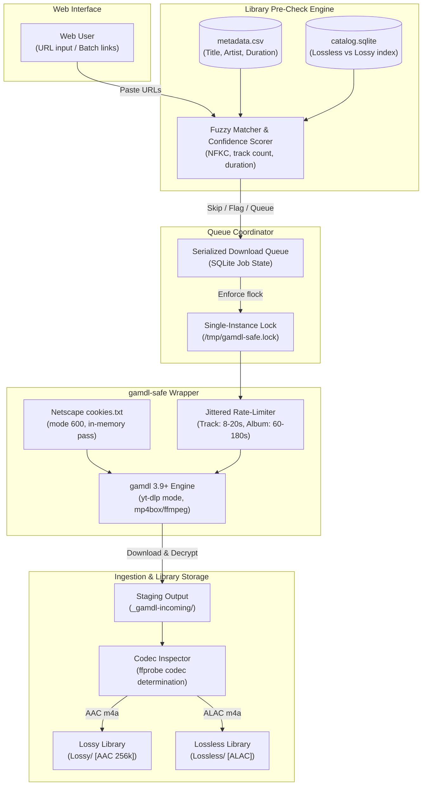

<div align="center">

# gamdl-dashboard

### Apple Music Download Queue & Library Pre-Check Dashboard

A lightweight, web-based download manager and queue coordinator for Apple Music via gamdl. Features serialized task execution, anti-ban rate limiting, library pre-checking against local catalogs, and a qBittorrent/IDM-style desktop interface.

[](#tech-stack-matrix)
[](https://github.com/glomatico/gamdl)
[-informational?style=flat-square)](#access--deployment-media-hosts)
[-brightgreen?style=flat-square)](#access--deployment-media-hosts)
[](LICENSE)

[Architecture](#architecture--queue-pipeline) · [Features](#key-features) · [Deployment](#access--deployment-media-hosts) · [Configuration](#gamdl--storage-configuration) · [Troubleshooting](#troubleshooting)

</div>

---

> Built for music archivists: an unattended queue daemon that serializes Apple Music downloads, prevents account bans through randomized pacing, and prevents duplicate downloads by cross-referencing existing library catalogs.

---

## Architecture & Queue Pipeline

The dashboard acts as an operational supervisor over `gamdl`, decoupling browser interactions from downloader execution through a strictly serialized local queue and safety wrapper.



---

## Key Features

<table>
  <tr>
    <td width="50%" valign="top">
      <h4>Queue Coordination & Safe Execution</h4>
      <ul>
        <li><strong>Strict Queue Serialization</strong>: Enforces <code>/tmp/gamdl-safe.lock</code> via <code>flock</code> to ensure only 1 URL runs at a time, protecting the account from bans.</li>
        <li><strong>Jittered Rate-Limiting</strong>: Randomized track delay (8–20s) and album cooldown (60–180s) via <code>gamdl-safe.py</code> with exponential backoff on HTTP 429/403 errors.</li>
        <li><strong>Library Duplicate Pre-Check</strong>: Cross-references candidate URLs against <code>metadata.csv</code> and <code>catalog.sqlite</code> before entering the queue.</li>
        <li><strong>Automatic Codec Detection</strong>: Flags finished albums via <code>ffprobe</code> as AAC 256k (for <code>Lossy/</code>) or ALAC (for <code>Lossless/</code>).</li>
        <li><strong>Secure Cookie Handling</strong>: Reads Netscape <code>cookies.txt</code> with mode 600 without logging or exposing sensitive tokens.</li>
      </ul>
    </td>
    <td width="50%" valign="top">
      <h4>User Interface & Operations</h4>
      <ul>
        <li><strong>qBittorrent/IDM-Inspired Dashboard</strong>: Responsive web dashboard running on port 8110 on <code>media-hosts</code> with vanilla JS and zero build steps.</li>
        <li><strong>Real-Time Telemetry</strong>: Per-album and per-track progress bars with live speed, dynamic ETA calculations, and Server-Sent Events (SSE).</li>
        <li><strong>Task Queue Controls</strong>: Pause after current track, resume, cancel active tasks, and inspect live stdout/stderr log panel.</li>
        <li><strong>Staging to Library Helper</strong>: Automates moving albums into standard <code>Lossless/</code> or <code>Lossy/</code> paths adhering to naming conventions (<code>Romaji (Kanji) ~</code>).</li>
        <li><strong>Centralized Notification</strong>: Proactive visual alert banner for auth expiry or expired cookies.</li>
      </ul>
    </td>
  </tr>
</table>

---

## Tech Stack Matrix

| Layer | Technology | Purpose |
|---|---|---|
| **Daemon & API Server** | Python 3.10+ / FastAPI | Serves web UI, SSE event bus, queue coordination, and SQLite persistence |
| **Downloader Core** | gamdl 3.9+ via pipx | Apple Music stream extraction, decryption, and tag embedding |
| **Process Serializer** | `gamdl-safe` wrapper (`flock`) | Enforces randomized delays, single-instance execution, and 429 backoff |
| **Stream Inspector** | `ffmpeg` / `ffprobe` | Analyzes audio streams to distinguish AAC 256k from ALAC audio |
| **Host Container** | Proxmox LXC 104 (`media-hosts`) | Unprivileged container hosting storage mounts and download services |
| **Networking & Access** | LAN & Tailscale (Port 8110) | Private internal access without exposing external public ingress |

---

## Access & Deployment (`media-hosts`)

The dashboard runs inside unprivileged container `media-hosts` (LXC 104) and is strictly intended for private LAN and Tailscale access.

### Network Endpoints & Topology

| Environment | Hostname / IP | Port | Protocol | Access Boundary |
|---|---|---|---|---|
| **Local Area Network** | `192.168.18.229` | `8110` | HTTP | LAN Subnet only |
| **Tailscale VPN** | `100.113.250.97` | `8110` | HTTP | Authenticated Tailnet nodes |
| **Host Container** | `media-hosts` (LXC 104) | `8110` | Systemd | Container local bind |

> [!IMPORTANT]
> The API has no public authentication. It must never be exposed to public WAN ingress or unauthenticated reverse proxy paths. Keep port 8110 firewalled to LAN and Tailscale interfaces.

### Service Installation & Lifecycle

Deploy natively on Linux using systemd:

```bash
# 1. Clone repository to target directory
git clone https://github.com/samsmon/gamdl-dashboard /opt/gamdl-dashboard
cd /opt/gamdl-dashboard

# 2. Install prerequisites and execute systemd installer
sudo apt install -y python3-venv ffmpeg
sudo ./deploy/install.sh --host 0.0.0.0

# 3. Check daemon status and follow runtime logs
sudo systemctl status gamdl-dashboard.service
sudo journalctl -u gamdl-dashboard.service -f
```

> [!NOTE]
> LXC 104 is an unprivileged container. User/group translation causes internal `chown 100000:100000` to fail. Always apply `chmod 777` on shared staging directories across storage mounts.

---

## gamdl & Storage Configuration

### Directory Layout & Storage Topology

Downloads land in an ephemeral staging folder on the primary storage pool before manual library filing:

```
/mnt/hdd-backup/music/
├── _gamdl-incoming/             # Staging landing directory (chmod 777)
│   ├── .tmp/                    # Intermediate segment storage
│   └── <Artist>/<Album>/        # Completed downloads awaiting classification
├── metadata.csv                 # Master library metadata catalog (read-only)
├── catalog.sqlite               # Master file index (25k+ tracks, read-only)
├── Lossless/                    # Target library destination for verified ALAC
└── Lossy/                       # Target library destination for AAC 256k
```

### Core Configuration Files & Environment

* **`config.ini` Location**: `/root/.gamdl/config.ini`
  ```ini
  [gamdl]
  output_path = /mnt/hdd-backup/music/_gamdl-incoming
  temp_path = /mnt/hdd-backup/music/_gamdl-incoming/.tmp
  cookies_path = /root/.gamdl/cookies.txt
  use_wrapper = false
  overwrite = false
  song_codec_piority = aac-web
  download_mode = ytdlp
  ```
  *(Note: `song_codec_piority` is preserved verbatim per upstream gamdl naming).*

* **Cookies File**: `/root/.gamdl/cookies.txt` (Netscape format, Apple domain only, `chmod 600`).
* **Environment Variables**:
  | Variable | Default Value | Description |
  |---|---|---|
  | `GAMDL_DASH_PORT` | `8110` | HTTP port for web UI and API |
  | `GAMDL_DASH_HOST` | `127.0.0.1` | Network interface to bind (`0.0.0.0` for LAN) |
  | `GAMDL_DASH_STAGING` | `/mnt/hdd-backup/music/_gamdl-incoming` | Staging landing directory |
  | `GAMDL_DASH_DISK_PATH` | `/mnt/hdd-backup` | Mount point checked for low-disk pause |
  | `GAMDL_DASH_COOKIES` | `/root/.gamdl/cookies.txt` | Path to Apple Music session cookies |
  | `GAMDL_DASH_LIBRARY_CSV`| `/mnt/hdd-backup/music/metadata.csv` | Master metadata file for fuzzy match |

---

## Pre-Check & Classification Rules

Before dispatching an album URL into execution, the pre-check engine cross-references candidate metadata against existing library catalogs:

1. **`in library (lossless)`**: If `metadata.csv` or `catalog.sqlite` confirms an existing lossless album, download is skipped by default.
2. **`in library (lossy)`**: If only a lossy rip exists and the candidate download is AAC, the dashboard flags the duplicate for manual confirmation.
3. **`similar (needs confirmation)`**: Fuzzy match score indicates potential overlap (e.g. Japanese kanji vs romaji transliteration), prompting for operator confirmation.
4. **`new`**: No match found in either library catalog or staging directory; album is queued automatically.
5. **Storefront Alignment**: Fetches metadata via Japanese storefront (`/jp/` via `GAMDL_STOREFRONT`) so artist names align with existing library tags (`Romaji (Kanji) ~`).
6. **Manual Override**: The operator may click "Download Anyway" to bypass automated heuristic skip recommendations.

### Real-Time Telemetry & Log Parsing

The runner captures stdout streams emitted by `gamdl` and `yt-dlp`:
* **Carriage Return Buffer**: `yt-dlp` emits progress fragments with `\r`, which the runner buffers to extract active percentages, download speeds, and ETAs.
* **Wrapper Delays**: Log notices such as `[gamdl-safe] track delay 12s` or `[gamdl-safe] album delay 87s` are surfaced directly in the dashboard status columns.

---

## Troubleshooting

| Symptom | Probable Cause | Immediate Remediation |
|---|---|---|
| **HTTP 401 / Auth Failed** | Apple Music session cookies have expired | Export fresh `cookies.txt` from browser, copy to `/root/.gamdl/cookies.txt`, and run `chmod 600 /root/.gamdl/cookies.txt`. |
| **Queue Blocked / Stalled** | Stale `/tmp/gamdl-safe.lock` from an interrupted process | Check if gamdl is active: `pgrep -a gamdl`. If not running, clear lock: `rm -f /tmp/gamdl-safe.lock`. |
| **Staging Permission Error** | Unprivileged LXC container UID mapping mismatch | Adjust permissions on the shared mount: `chmod -R 777 /mnt/hdd-backup/music/_gamdl-incoming`. |
| **Low Disk Warning (<10%)** | Mount `/mnt/hdd-backup` running low on storage | Check available capacity with `df -h /mnt/hdd-backup`. Clean `.tmp/` or file completed albums into library. |
| **HTTP 429 Rate Limit** | Cooldown delay thresholds set too low | The wrapper auto-backs off; ensure `GAMDL_TRACK_DELAY` is at least `8-20`s and `GAMDL_ALBUM_DELAY` is `60-180`s. |

---

## Modular Documentation Index

| Document | Description | Target Audience |
|---|---|---|
| [Project Brief](BRIEF.md) | Original architecture specifications, design constraints, and operational logs | Developers & Maintainers |
| [Safe Wrapper Implementation](app/gamdl_safe.py) | Python monkeypatch wrapper handling process flock serialization and delay pacing | Backend Engineers |
| [Deployment Runbook](deploy/README.md) | Service unit installation, systemd automation, and host networking setup | SRE & System Operators |
| [Music Ingestion Standards](docs/music-standards.md) | Canon tagging guidelines, directory hierarchy conventions, and audio codec rules | Archivists & Curators |

---

<div align="center">

Distributed under the [MIT License](LICENSE).

[Back to top](#gamdl-dashboard)

</div>
